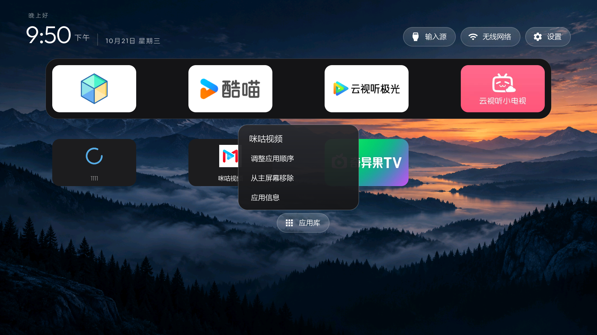

# App library

Set `"app_library": true` in a theme’s `config.json`, or enable the `app_library`
bool in `config.xml`. It is off by default. A small glass pill appears after the
last row of Home apps.

The horizontal library lists installed apps with a TV or ordinary Android launch
activity, preferring the TV entry when both exist. It excludes services and apps
without a launch activity. Ordinary Android apps may still need touch or a mouse.

Apps missing from Home come first. Apps first installed within the last seven
days lead that group, newest first, with a green dot; older missing apps are
alphabetical. Apps already on Home follow alphabetically, with a checkmark and a
subtle tint. Updating an existing app does not mark it as new.

- Press OK on a missing app to add it to Home. Focus advances to the next missing
  app without following the new shortcut across the catalogue.
- Press OK on a checked app to open it.
- Hold OK for Open, Add to Home or Remove from Home, and App info. The menu uses
  the existing Inputs dropdown resources and stays over the selected card.
- Back closes the menu first, then the library. Down from the last Home row or
  Right from the final app reaches the library pill; Up returns to the last row.
  Hebrew mirrors the horizontal direction, so Left from the final app reaches it.

Every checked app can be removed from Home, including the theme’s default apps.
It stays installed and remains in the library, where one press adds it back.
There is no hidden-app section and no uninstall action.

## Manage a shortcut from Home

With the app library enabled, select an ordinary Home app and **hold OK** or
press the remote's **Menu** key. The shortcut menu offers Reorder apps, Remove
from Home and App info. A normal OK press still opens the app. Back dismisses
the menu without changing anything. Module cards and the default-Home settings
tile retain their previous behavior.

Removing an app hides its Home shortcut, including a theme default or a manually
added shortcut. It stays installed. Open the app library and press OK on that
app to add it back. This uses the same saved choices as the library's own menu;
it does not edit the theme or uninstall anything. The menu uses the existing
translated labels and guards against the OK-up event that opened it activating
its first action.

The Home menu is available only while `app_library` is enabled, so there is
always an on-TV path to add a removed shortcut back. With the library disabled,
Home long-press still opens App info as before, and Menu is not intercepted.

Tested on a Haier `HRA962X2_2G_ALI6G_A` (API 28), in a local build with the
library enabled: long-press and Menu both opened the menu, a shortcut could be
removed while its app stayed installed, the library added it back, and reorder
mode could be entered and cancelled. The screenshot shows that local build;
its Haier-specific Home/settings adaptations are separate from this feature.

Choices are stored in the launcher’s private `library_apps.txt` and
`library_home_removed.txt`, with at most 128 entries in each. Each file is written
atomically. An unreadable file is left unchanged if an edit fails. Choices
survive restarts and app updates; missing or disabled packages are omitted until
they return. Explicit Home removals override theme defaults until re-added.
Theme config, dock ordering, module-card decisions and other saved tile order
are not edited. Disabling the library button keeps existing Home choices.

The library uses the existing package receiver to refresh after app changes.
Labels and Home membership are cached for each refresh; icons load only for
bound cards. The highlight follows the launcher's animation setting, including
instant movement when animations are off. There is no polling, network, backdrop capture, new service,
permission or dependency. The additional manifest query covers ordinary
LAUNCHER activities on Android 11 and later.
